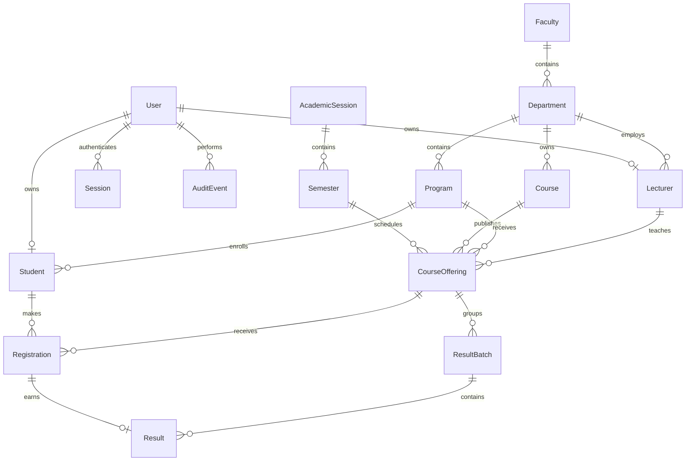

# UEMP architecture and academic policy

## Application architecture

UEMP is one Next.js App Router application. Public and authenticated pages live under `app`; JSON Route Handlers under `app/api` validate HTTP input and delegate to server-only domain services. Those services authenticate the session, authorize the account role and ownership, and query PostgreSQL through Prisma. Browser requests use Axios, while TanStack Query owns remote state and mutation invalidation. React Hook Form and Zod own interactive form state and validation.

Authentication is custom and uses opaque, hashed session tokens in secure HttpOnly cookies. Sessions and login throttles are persisted in PostgreSQL, not process memory or Redis. Every academic service rechecks account status and role. Student identity always comes from the authenticated session; no Student endpoint accepts a client-supplied student ID.

## Entity relationship diagram

Historical integrity comes from restricted foreign-key deletion, unique registration and offering constraints, registration credit-unit snapshots, and result grade-point snapshots.

## Permission matrix

| Capability | Student | Lecturer | Administrator |
| --- | :---: | :---: | :---: |
| View own academic identity and contact details | Yes | No | No |
| Edit own phone and address | Yes | No | No |
| Register eligible courses | Yes | No | No |
| View own approved results and history | Yes | No | No |
| Print own registration and approved result summaries | Yes | No | No |
| View assigned offering rosters | No | Yes | No |
| Save and submit assigned result batches | No | Yes | No |
| Create catalogue courses and semester offerings | No | No | Yes |
| Approve or reject submitted result batches | No | No | Yes |
| Create role-aware user accounts | No | No | Yes |
| Suspend or reactivate user access | No | No | Yes |
| Revoke another user’s sessions or reset password | No | No | Yes |

Account roles are immutable after creation because they anchor academic profiles and historical relationships. Administrators manage access through account status and session revocation instead of rewriting institutional identity.

UI routing is a convenience, not the authorization boundary. Every service entry point checks active account status, exact role, assignment or ownership, and resource state.

## Grading policy

The demonstration policy assumes continuous assessment from 0–30 and examination scores from 0–70. Totals map continuously to A at 70 or above, B at 60–69.99, C at 50–59.99, D at 45–49.99, E at 40–44.99, and F below 40. Grade points are 5 through 0 respectively.

GPA and CGPA use `sum(credit units × grade points) / sum(credit units)`. Failed courses remain in attempted units. Semester GPAs are never averaged to calculate CGPA, and rounding occurs only for displayed final values. Only results in approved batches enter Student APIs, dashboard summaries, history, GPA, CGPA, and printable statements.

These thresholds are implementation assumptions for the assessment demonstration, not a claim about an institution-wide policy. Retake and replacement rules are outside scope.

## Deployment and operational notes

Production requires one Next.js deployment and PostgreSQL. Set `DATABASE_URL`, `AUTH_ORIGIN`, and production secrets in the hosting provider; use HTTPS, configure database pooling, run `npm run db:deploy`, and then start the built application. Schedule `npm run auth:cleanup` for expired session and throttle records. Verify pooling and concurrent registrations against the selected PostgreSQL host.

Browser printing creates non-certified student copies. Payment, admissions, accommodation, biometrics, messaging integrations, transcript certification, native mobile apps, and external university integrations are excluded.
